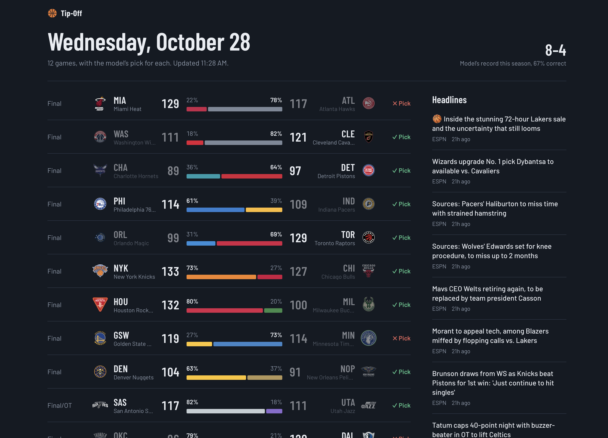
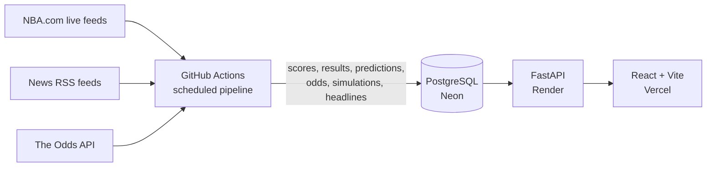

# Tip-Off: NBA Predictions, Playoff Odds, and a Live Benchmark Against the Betting Market


A full-stack NBA forecasting site. Every day it shows each game with live scores and a machine learning model's win probability, compares that probability with the betting market's, and simulates the rest of the season 10,000 times to project standings and playoff odds.

**Live site:** [https://nba-dashboard-nu.vercel.app/#](https://nba-dashboard-nu.vercel.app/#) (the first load can take up to a minute while the free server wakes up)



## What it does

- **Daily predictions.** A logistic regression model estimates every game's win probability from information available before tip-off. Predictions lock before each game starts and are never changed, and the site tracks the model's running record.
- **A live benchmark against the betting market.** Before each game, sportsbook moneyline odds are converted to win probabilities with the bookmakers' margin removed, and the median across books is saved next to the model's prediction. The site compares the two on accuracy and log loss as games finish, and flags games where they pick different winners.
- **Season simulation.** Each morning the remaining schedule is played out 10,000 times using the model's probabilities, followed by the play-in tournament and a full best-of-seven playoff bracket. The Playoff odds page shows every team's projected record and its chances of reaching the playoffs, the conference finals, the Finals, and winning the title.
- **Headlines** from several sports news feeds, refreshed every three hours.

## Model results

Evaluated on all 1,225 games of the 2025-26 regular season, which the model never saw during training or tuning:

| Approach | Accuracy | Log loss | Brier score |
|---|---|---|---|
| Always pick the home team | 55.4% | 0.6875 | 0.2472 |
| Pick the higher Elo rating | 67.7% | 0.6066 | 0.2087 |
| Gradient boosting | 67.0% | 0.6012 | 0.2072 |
| **Logistic regression (deployed)** | **68.1%** | **0.5953** | **0.2045** |

Accuracy is only slightly above a well-tuned Elo rating, which is typical: NBA games are noisy, and Elo already captures most of the signal in team strength. The larger gain is in log loss and Brier score, meaning the model's probabilities are better calibrated, which matters because the site shows probabilities rather than just picks. Logistic regression beat gradient boosting, likely because a few thousand games favors a simpler, more regularized model.

Accuracy also varies through a season. Early games are harder to call, because rolling stats still include the previous season and Elo hasn't caught up to offseason roster changes, so the training script reports test-season accuracy by month as a fair benchmark for the live record.

The betting market is the harder benchmark, since prices reflect the views of a very large number of bettors. The live comparison started at the beginning of November 2026, and its running results are on the site.

## How the model works

**Data.** About 4,900 regular-season games from 2022-23 onward, pulled from NBA.com with [`nba_api`](https://github.com/swar/nba_api), stored as one row per game plus one row per team per game with box score stats.

**Features.** Every feature uses only information available before tip-off:

- **Elo ratings** updated after every game, with a margin-of-victory multiplier, a home-court adjustment, and 25% regression to the mean between seasons
- **Rolling 10-game averages** of offensive, defensive, and net rating (points per 100 possessions), pace, and the Four Factors: effective FG%, turnover rate, offensive rebound rate, and free throw rate
- **Season-to-date win percentage**
- **Rest days and back-to-backs** for each team

Features are home-minus-away differences. Rolling stats are shifted by one game and Elo is recorded before each game updates it, so no game's result leaks into its own prediction. A test enforces this directly: it flips a game's result and confirms that game's features, and every earlier game's, are unchanged. The same code builds features for training and for live predictions, and another test confirms the two produce identical values.

**Validation.** Seasons are split by time, never randomly: the first season is a warm-up while Elo ratings settle, the model is fit on 2023-24, hyperparameters are chosen on 2024-25, and 2025-26 is used once for the final score. The chosen model is then refit on every completed season before deployment.

## How the season simulation works

Each of the 10,000 simulations:

1. **Draws a random strength adjustment for every team.** A team's current numbers are only an estimate of its true quality, so each simulated season nudges every team up or down in log-odds. The spread shrinks with the square root of the share of the season left, which keeps early projections from being overconfident.
2. **Plays every remaining game** with the model's probability for that matchup, using each team's real rest days and back-to-backs from the schedule.
3. **Seeds each conference, runs the play-in tournament** (7 vs. 8, 9 vs. 10, then the 8th-seed game), and **plays best-of-seven series** with home court for the higher seed. Series odds come from an exact calculation over the 2-2-1-1-1 home pattern.

Until early December, the NBA Cup leaves each team's last two games unscheduled, so the simulator adds placeholder games against random same-conference opponents so every team plays 82. Ties in the standings are broken at random rather than with the NBA's full tiebreakers, and team strength stays fixed within each simulated season. Tests confirm the probabilities are internally consistent: exactly 8 playoff teams per conference, exactly one champion, each round harder to reach than the last.

## Architecture



- **Scheduled pipeline (GitHub Actions):** refreshes scores every 15 minutes during game hours; twice a day adds finished games to the history, makes predictions, saves market odds, and reruns the season simulation; pulls headlines every three hours.
- **Database (PostgreSQL on Neon):** shared by the pipeline and the API. The code also runs on a local SQLite file when no database URL is set.
- **Backend (FastAPI on Render):** read-only endpoints for games with predictions and market odds, headlines, model performance, and playoff projections, with interactive docs at `/docs`.
- **Frontend (React + Vite on Vercel):** responsive dark interface. Each game's win probability is drawn as a bar split in the two teams' colors, with a marker showing the market's number.
- **Continuous integration:** every push runs the test suite and a frontend build.

**Working around blocked data sources.** NBA.com blocks several of its data sources from cloud servers, which shaped the design. The multi-season history and the season schedule are downloaded from a home connection and saved in the database. The deployed pipeline keeps both current using the NBA's live scoreboard and box score feeds, which aren't blocked: each finished game is added to the history, and the saved schedule is updated with final scores from it. Headlines come from several sources, so one feed refusing cloud traffic doesn't leave the site without news.

## Tech stack

Python, pandas, NumPy, scikit-learn, FastAPI, SQLAlchemy, PostgreSQL, pytest, React, Vite, GitHub Actions, Render, Vercel, Neon

## Running it locally

**Backend** (Python 3.12+):

```bash
cd backend
python -m venv .venv
source .venv/bin/activate          # Windows: .venv\Scripts\activate
pip install -r requirements-dev.txt

python run_pipeline.py history     # several seasons of results (a few minutes)
python run_pipeline.py train       # build features, train, evaluate, save the model
python run_pipeline.py schedule    # this season's schedule
python run_pipeline.py predict     # today's predictions, market odds, and the simulation
python run_pipeline.py headlines

python -m pytest                   # run the tests
uvicorn app.main:app --reload      # API at http://127.0.0.1:8000/docs
```

Settings go in `backend/.env` (never committed):

- `DATABASE_URL=postgresql://...` to use PostgreSQL. Without it, everything uses a local SQLite file.
- `ODDS_API_KEY=...` for market odds, from a free key at the-odds-api.com. Without it, odds are skipped.

**Frontend** (Node 20+), in a second terminal:

```bash
cd frontend
npm install
npm run dev                        # http://localhost:5173
```

## Project structure

```
backend/
  app/          FastAPI app and response schemas
  model/        features, training, daily predictions, season simulation, saved model
  pipeline/     data collection: scoreboard, history, results, schedule, odds, headlines
  tests/        pytest suite (leakage, features, pipeline, simulation, odds, API)
  db.py         database helpers (SQLite or PostgreSQL)
  run_pipeline.py   command-line entry point
frontend/
  src/          React components, API client, styles
.github/workflows/
  pipeline.yml  scheduled data updates
  tests.yml     tests and build on every push
```

## Possible improvements

- Add player availability (injuries and rest days for stars), likely the biggest missing signal
- A dedicated model-vs-market page: running accuracy and log loss, calibration charts, and a game-by-game log
- Account for travel distance and time zones
- Implement the NBA's full tiebreaker rules in the simulation

---

Predictions are for entertainment, not betting advice. Game data from NBA.com; headlines from ESPN, CBS Sports, and Yahoo Sports; odds from The Odds API. Not affiliated with the NBA.
