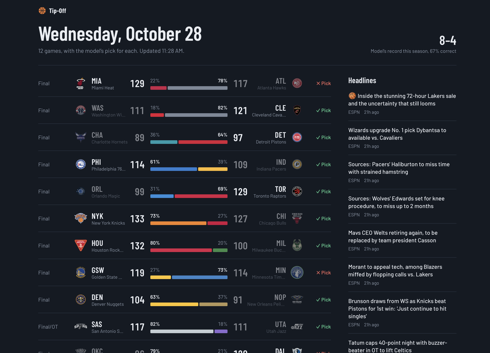
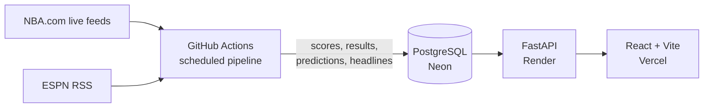

# Tip-Off: NBA Games, Headlines, and Win Predictions

A full-stack dashboard that shows each day's NBA games with live scores, the latest headlines, and a machine learning model's predicted winner and win probability for every matchup.

**Live site:** (https://nba-dashboard-nu.vercel.app) (the first load can take up to a minute while the free server wakes up)



## Results

The model was evaluated on all 1,225 games of the 2025-26 regular season, which it never saw during training or tuning.

| Approach | Accuracy | Log loss | Brier score |
|---|---|---|---|
| Always pick the home team | 55.4% | 0.6875 | 0.2472 |
| Pick the higher Elo rating | 67.7% | 0.6066 | 0.2087 |
| Gradient boosting | 67.0% | 0.6012 | 0.2072 |
| **Logistic regression (deployed)** | **68.1%** | **0.5953** | **0.2045** |

Accuracy is only slightly above a well-tuned Elo rating, which is typical: NBA games are noisy, and Elo already captures most of the signal in team strength. The larger gain is in log loss and Brier score, meaning the model's win probabilities are better calibrated, which matters because the dashboard shows probabilities rather than just picks. Logistic regression beat gradient boosting, likely because a few thousand games favors a simpler, more regularized model.

Live predictions are locked before each tip-off and never changed afterward, and the dashboard tracks the model's running record for the current season.

## How the model works

**Data.** About 4,900 regular-season games from 2022-23 onward, pulled from NBA.com with [`nba_api`](https://github.com/swar/nba_api), stored as one row per game plus one row per team per game with box score stats.

**Features.** Every feature uses only information available before tip-off:

- **Elo ratings** updated after every game, with a margin-of-victory multiplier, a home-court adjustment, and 25% regression to the mean between seasons
- **Rolling 10-game averages** of offensive, defensive, and net rating (points per 100 possessions), pace, and the Four Factors: effective FG%, turnover rate, offensive rebound rate, and free throw rate
- **Season-to-date win percentage**
- **Rest days and back-to-backs** for each team

Features are home-minus-away differences. Rolling stats are shifted by one game and Elo is recorded before each game updates it, so no game's result leaks into its own prediction. The same code builds features for training and for live predictions, and a test confirms the two paths produce identical values.

**Validation.** Seasons are split by time, never randomly: the first season is a warm-up while Elo ratings settle, the model is fit on 2023-24, hyperparameters are chosen on 2024-25, and 2025-26 is used once for the final score. The chosen model is then refit on every completed season before deployment.

## Architecture



- **Scheduled pipeline (GitHub Actions):** refreshes scores every 15 minutes during game hours, adds finished games to the history, makes predictions twice daily, and pulls headlines every 3 hours.
- **Database (PostgreSQL on Neon):** shared by the pipeline and the API. The code also runs on a local SQLite file when no database URL is set.
- **Backend (FastAPI on Render):** read-only endpoints for games with predictions, headlines, and model performance, with interactive docs at `/docs`.
- **Frontend (React + Vite on Vercel):** responsive dark interface. Each game's win probability is drawn as a bar split in the two teams' colors, and scores refresh every minute.

One practical constraint shaped the design: NBA.com's stats site often blocks requests from cloud servers, while its live scoreboard and box score feeds do not. So the multi-season history is pulled once from a local machine, and the deployed pipeline keeps it current by adding each finished game from the live box score feed.

## Tech stack

Python, pandas, scikit-learn, FastAPI, SQLAlchemy, PostgreSQL, React, Vite, GitHub Actions, Render, Vercel, Neon

## Running it locally

**Backend** (Python 3.12+):

```bash
cd backend
python -m venv .venv
source .venv/bin/activate          # Windows: .venv\Scripts\activate
pip install -r requirements.txt

python run_pipeline.py history     # several seasons of results (a few minutes)
python run_pipeline.py train       # build features, train, evaluate, save the model
python run_pipeline.py predict     # today's games and predictions
python run_pipeline.py headlines

uvicorn app.main:app --reload      # API at http://127.0.0.1:8000/docs
```

Without a `DATABASE_URL`, everything uses a local SQLite file. To use PostgreSQL, put `DATABASE_URL=postgresql://...` in `backend/.env`.

**Frontend** (Node 20+), in a second terminal:

```bash
cd frontend
npm install
npm run dev                        # http://localhost:5173
```

## Project structure

```
backend/
  app/          FastAPI app and response schemas
  model/        feature engineering, training, prediction, saved model
  pipeline/     data collection: scoreboard, history, results, headlines
  db.py         database helpers (SQLite or PostgreSQL)
  run_pipeline.py   command-line entry point
frontend/
  src/          React components, API client, styles
.github/workflows/pipeline.yml   scheduled data updates
```

## Possible improvements

- Add player availability (injuries and rest days for stars), likely the biggest missing signal
- Account for travel distance and time zones
- Show a calibration chart and daily accuracy history on the site

---

Predictions are for entertainment, not betting advice. Game data from NBA.com; headlines from ESPN. Not affiliated with the NBA.
